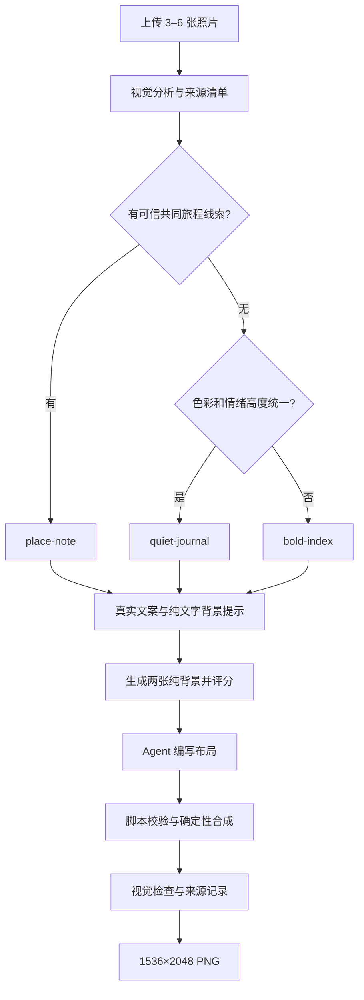

# Ins Photo Diary · Ins 风照片日记

将 **3–6 张真实生活照片** 排成一张有留白、有叙事的 **1536×2048（3:4）照片日记**。

Agent 理解照片、选择视觉模式、写克制文案并生成背景；随包 Python 脚本把原图和文字合成。全部原图各出现一次，只有背景允许生成。

> 此仓库根据用户提供的图文介绍独立重建。截图未提供原始源码、精确布局协议或完整运行入口；本仓库的脚本、参数、测试与打包流程是新实现，不是原作者源码的复原或官方发行版。来源说明见 [NOTICE.md](NOTICE.md)。

## 三种模式

| 模式 | 适用素材 | 排版与字体 |
|---|---|---|
| `bold-index` | 题材多样、色彩跳跃、事件感强 | Archivo Black；3–4 行栏目式结构 |
| `quiet-journal` | 色调和情绪统一、自然或静物 | Cormorant Garamond；中央小簇与大留白 |
| `place-note` | 有可信共同地点或旅程线索 | Inter Light；照片嵌入视觉句子 |

默认先判断共同地点/旅程，再判断统一情绪，最后采用栏目模式。两种模式都合理时在同一背景上比较预览。用户无需手选模板或填写 JSON。

## 安装与使用

运行要求：Python 3.10+、Pillow，以及宿主 Agent 的视觉理解、本地文件执行和可保存位图的图片生成能力。安装 Python 依赖：

```bash
python3 -m pip install -r requirements.txt
```

将整个 `compose-ins-photo-diary` 目录放入宿主配置的 Skills 目录，或让 Agent 直接读取根目录 `SKILL.md`。不要只复制入口文件，渲染还依赖参考协议、脚本、字体和 ICC 文件。

对支持导入 `.skill` 归档的宿主，可导入发布包；`.skill` 在本项目中是保留顶层 Skill 文件夹的 ZIP 归档，**并非所有宿主都有这种导入功能**。不支持时解压目录使用。

本包采用通用 `SKILL.md` 入口；`agents/openai.yaml` 是可选界面元数据，其他宿主可忽略。实际兼容性取决于宿主能力与版本，本项目不声称已验证所有 Agent 产品。

上传 3–6 张照片，然后说：

> 用 $compose-ins-photo-diary 把这些照片做成一张 Ins 风照片日记。

> 把这 5 张生活照做成一张 mood collage，由你选择排版和背景，小图必须保留原图。

> 用这些旅行照片做一张有地点感的 3:4 视觉日记，地点只用我提供或图中能确认的信息。

## 工作流程



用户照片只供宿主视觉理解及本地合成，不附加到背景生成请求。脚本不调用任何厂商 API，不包含密钥，不自动上传照片。

前景只进行方向校正、色彩空间转换、裁切、缩放和受控旋转。不会重绘、调色、换脸、补画或增加相框、贴纸、投影。缺少生图能力时停止正式出图，不要求提供 API Key 作为替代。

## 目录

```text
compose-ins-photo-diary/
├── SKILL.md
├── README.md
├── LICENSE
├── NOTICE.md
├── requirements.txt
├── agents/openai.yaml
├── references/
│   ├── aesthetic-system.md
│   └── layout-contract.md
├── scripts/
│   ├── compose_ins_diary.py
│   └── package_skill.py
├── assets/
│   ├── srgb.icc
│   └── fonts/                   # 三种字体、各自 OFL、下载摘要
├── tests/test_compositor.py
├── evals/behavior-cases.md
└── .github/workflows/check.yml
```

`SKILL.md` 是运行入口；参考文件分别负责审美和布局；`README.md` 面向安装与维护。测试和行为评估不进入精简 `.skill` 包。

## 开发验证与打包

```bash
python3 -m unittest discover -s tests -v
python3 scripts/package_skill.py --output-dir dist
```

打包脚本输出完整仓库 ZIP、精简 `.skill` 包和 SHA-256 校验文件；采用文件白名单，不包含用户照片、工作目录、缓存或个人环境。测试使用临时生成的几何图案，仅验证渲染器，不代表真实照片的美学成片。端到端审美评估用例在 [evals/behavior-cases.md](evals/behavior-cases.md)。

## 上传到 GitHub

1. 新建名为 `compose-ins-photo-diary` 的空仓库。
2. 将本目录内的完整文件结构上传到仓库根目录，确保 `SKILL.md` 位于根目录，并保留字体及许可证。若使用网页上传，确认 `.github/workflows/check.yml` 也被保留；它负责运行自动测试。
3. 可将生成的 `.skill` 放入 GitHub Release 作为下载附件。ZIP 用于分发和备份；仅上传 ZIP 不会自动展开为仓库源码。

不需要上传说明截图或个人生活照。本仓库没有附带真人照片案例，避免把特定成片误当固定模板。

## 许可与范围

本重建版新写代码与文档按 [MIT](LICENSE) 提供。Archivo Black、Cormorant Garamond、Inter 保持各自 [OFL 许可](assets/fonts/)，其上游地址、文件摘要见 `assets/fonts/manifest.json`。截图原项目及其作者的权利不由本仓库许可覆盖。

“Ins 风”指 Instagram-inspired 编辑视觉方向；本项目与 Instagram 无官方关系。
